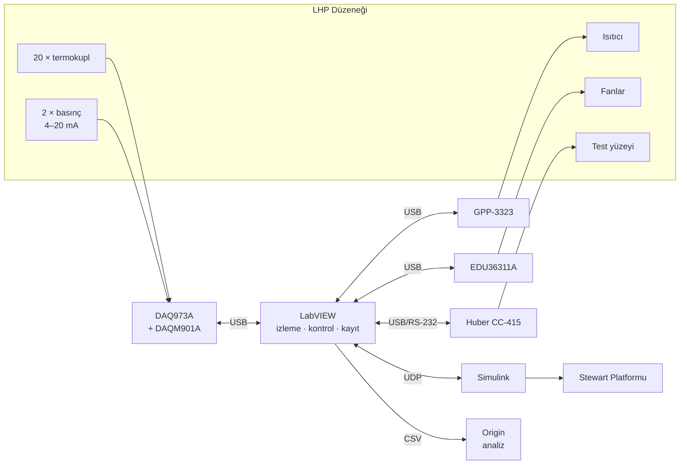

# Loop Heat Pipe – Kontrol ve Veri Toplama Sistemi

Bu repo, **Loop Heat Pipe (LHP) teknolojisine dayalı buz önleme uygulamaları için test altyapısı** projesinin **kontrol ve veri toplama** kısmını içerir.

> Durum: **Planlama / erken geliştirme.** Ekipmanlar belirlendi. Sensör konumları, ısıtıcı ve Stewart Platformu ayrıntıları netleşmedi. `docs/` altındaki belgeler taslaktır.

## Proje Hakkında

LHP, çalışma akışkanının buharlaşma–yoğuşma döngüsüyle ısıyı mekanik pompa olmadan taşıyan kapalı bir ısı transfer sistemidir. Projede, uçaklarda oluşan atık ısının kanat hücum kenarı gibi buzlanmaya açık bölgelere LHP ile taşınması deneysel olarak incelenmektedir.

- **LHP düzeneği** İTÜ'de kurulacaktır (evaporatör tarafı + kondenser tarafı, ısıtıcı, fanlar).
- **Dinamik testler**, düzenek Türk-Alman Üniversitesi'ndeki **Stewart Platformu** üzerine yerleştirilerek yapılacaktır.
- Amaç, açısal hareketler altında LHP'nin **verimli çalışıp çalışmadığını** gösteren bir test ortamı kurmaktır: başlangıç davranışı, termal direnç, çalışma sıcaklıkları ve yüzey sıcaklık dağılımı.

## Bu Reponun Kapsamı

| Alan | Açıklama | Araç |
|---|---|---|
| Veri toplama | 20 termokupl + 2 basınç transmitterinin sürekli, eş zamanlı okunması ve kaydı | LabVIEW + Keysight DAQ973A |
| Kontrol | Isıtıcı, fanlar ve soğutucunun sensör verilerine göre kontrolü, güvenlik limitleri | LabVIEW + güç kaynakları + Huber CC-415 |
| Platform entegrasyonu | Simulink ile çalışan Stewart Platformu'nun LabVIEW'dan komut alması ve durum bilgisinin kaydı | LabVIEW ↔ Simulink (UDP) |
| Analiz | Kaydedilen verilerin işlenmesi ve grafiklenmesi | Origin |

## Ekipman

| Ekipman | Model | Rolü |
|---|---|---|
| Veri toplama | Keysight DAQ973A + DAQM901A | 20 termokupl + 2 akım (basınç) kanalı |
| Güç kaynağı | GW Instek GPP-3323 | Isıtıcı beslemesi ve güç ölçümü |
| Güç kaynağı | Keysight EDU36311A | Fanlar ve basınç sensörü beslemesi (24 V) |
| Soğutucu | Huber CC-415 | Test yüzeyi soğutması (−40…200 °C) |
| Basınç sensörü | DMS20S (×2) | Mutlak basınç, 4–20 mA |
| Bilgisayar | Dell Precision T3680 | LabVIEW, Simulink, Origin |

Ayrıntılar: [docs/ekipman.md](docs/ekipman.md)

## Sistem Mimarisi (özet)



Detaylar: [docs/sistem-mimarisi.md](docs/sistem-mimarisi.md)

## Klasör Yapısı

```
.
├── docs/                 Proje belgeleri (mimari, kanal planı, haberleşme, yol haritası)
├── labview/              LabVIEW projesi ve VI'lar
├── simulink/             Simulink tarafındaki haberleşme blokları ve notlar
├── analysis/
│   └── origin/           Origin proje dosyaları ve şablonları
└── data/                 Örnek ve test verileri (büyük ham veriler repoya konmaz)
```

## Belgeler

- [Proje görevleri (iş adımları)](docs/gorevler.md)
- [Ekipman](docs/ekipman.md)
- [Sistem mimarisi](docs/sistem-mimarisi.md)
- [Sensör ve kanal planı](docs/kanal-plani.md)
- [LabVIEW–Simulink haberleşmesi](docs/labview-simulink-haberlesme.md)
- [Veri formatı](docs/veri-formati.md)
- [Yol haritası](docs/yol-haritasi.md)
- [Açık sorular](docs/acik-sorular.md)

## Ekip

- **Yiğit** – kontrol ve veri toplama
- **Alper** – kontrol ve veri toplama

İletişim (proje yürütücüsü): tekebudakli@tau.edu.tr
