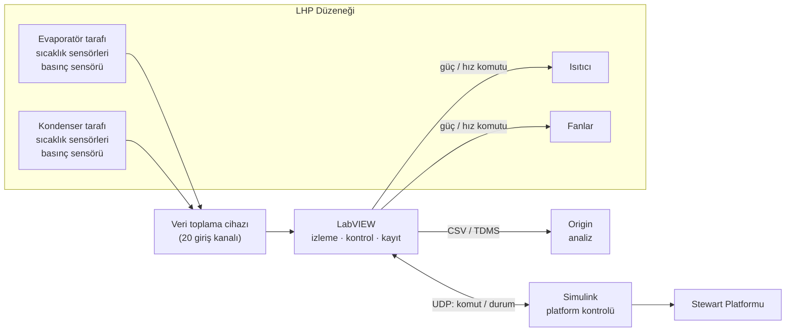

# Loop Heat Pipe – Kontrol ve Veri Toplama Sistemi

Bu repo, **Loop Heat Pipe (LHP) teknolojisine dayalı buz önleme uygulamaları için test altyapısı** projesinin **kontrol ve veri toplama** kısmını içerir.

> Durum: **Planlama / erken geliştirme.** Donanım (veri toplama cihazının marka/modeli, sensör tipleri) henüz kesinleşmedi. `docs/` altındaki belgeler taslaktır ve bilgiler netleştikçe güncellenecektir.

## Proje Hakkında

LHP, çalışma akışkanının buharlaşma–yoğuşma döngüsüyle ısıyı mekanik pompa olmadan taşıyan kapalı bir ısı transfer sistemidir. Projede, uçaklarda oluşan atık ısının kanat hücum kenarı gibi buzlanmaya açık bölgelere LHP ile taşınması deneysel olarak incelenmektedir.

- **LHP düzeneği** İTÜ'de kurulacaktır (evaporatör tarafı + kondenser tarafı, ısıtıcı, fanlar).
- **Dinamik testler**, düzenek Türk-Alman Üniversitesi'ndeki **Stewart Platformu** üzerine yerleştirilerek yapılacaktır.
- Amaç, açısal hareketler altında LHP'nin **verimli çalışıp çalışmadığını** gösteren bir test ortamı kurmaktır: başlangıç davranışı, termal direnç, çalışma sıcaklıkları ve yüzey sıcaklık dağılımı.

## Bu Reponun Kapsamı

| Alan | Açıklama | Araç |
|---|---|---|
| Veri toplama | ~12 sıcaklık + 2 dijital basınç sensörünün sürekli, eş zamanlı okunması ve kaydı | LabVIEW |
| Kontrol | Isıtıcı ve fanların sensör verilerine göre kontrolü, güvenlik limitleri | LabVIEW |
| Platform entegrasyonu | Simulink ile çalışan Stewart Platformu'nun LabVIEW'dan komut alması ve durum bilgisinin kaydı | LabVIEW ↔ Simulink (UDP) |
| Analiz | Kaydedilen verilerin işlenmesi ve grafiklenmesi | Origin |

## Sistem Mimarisi (özet)



Detaylar: [docs/sistem-mimarisi.md](docs/sistem-mimarisi.md)

## Klasör Yapısı

```
.
├── docs/                 Proje belgeleri (mimari, kanal planı, haberleşme, yol haritası)
├── labview/              LabVIEW projesi ve VI'lar
├── simulink/             Simulink tarafındaki haberleşme blokları ve notlar
├── analysis/
│   └── origin/           Origin proje dosyaları ve şablonları
└── data/                 Örnek ve test verileri (büyük ham veriler repoya konmaz)
```

## Belgeler

- [Sistem mimarisi](docs/sistem-mimarisi.md)
- [Sensör ve kanal planı](docs/kanal-plani.md)
- [LabVIEW–Simulink haberleşmesi](docs/labview-simulink-haberlesme.md)
- [Veri formatı](docs/veri-formati.md)
- [Yol haritası](docs/yol-haritasi.md)
- [Açık sorular](docs/acik-sorular.md)

## Ekip

- **Yiğit** – kontrol ve veri toplama
- **Alper** – kontrol ve veri toplama

İletişim (proje yürütücüsü): tekebudakli@tau.edu.tr
