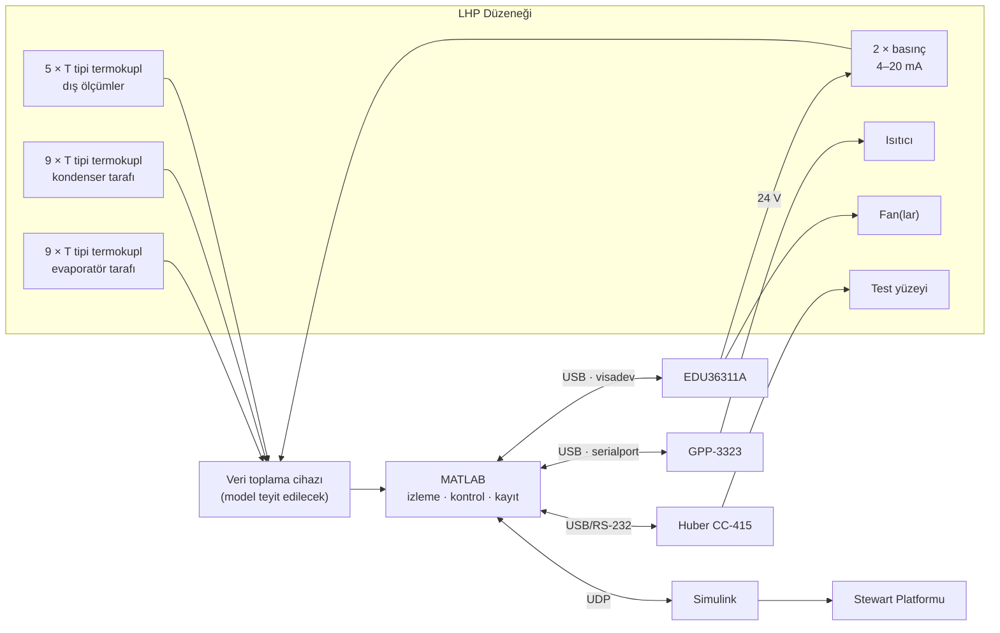

# Loop Heat Pipe – Kontrol ve Veri Toplama Sistemi

Bu repo, **Loop Heat Pipe (LHP) teknolojisine dayalı buz önleme uygulamaları için test altyapısı** projesinin **kontrol ve veri toplama** kısmını içerir.

> **Durum (Kasım 2026):** Kontrol ve veri toplama yazılımı olarak **MATLAB** kullanılmasına karar verildi (LabVIEW bırakıldı). Veri toplama cihazı değişti, yeni cihazın modeli kesinleşecek. İki güç kaynağı (GPP-3323 ve EDU36311A) MATLAB'dan kontrol edilebiliyor. Sıradaki adım, termokuplların yeni cihazdan MATLAB'a okunması.

## Proje Hakkında

LHP, çalışma akışkanının buharlaşma–yoğuşma döngüsüyle ısıyı mekanik pompa olmadan taşıyan kapalı bir ısı transfer sistemidir. Projede, uçaklarda oluşan atık ısının kanat hücum kenarı gibi buzlanmaya açık bölgelere LHP ile taşınması deneysel olarak incelenmektedir.

- **LHP düzeneği** İTÜ'de kurulacaktır (evaporatör tarafı + kondenser tarafı, ısıtıcı, fanlar).
- **Dinamik testler**, düzenek Türk-Alman Üniversitesi'ndeki **Stewart Platformu** üzerine yerleştirilerek yapılacaktır.
- Amaç, açısal hareketler altında LHP'nin **verimli çalışıp çalışmadığını** gösteren bir test ortamı kurmaktır: başlangıç davranışı, termal direnç, çalışma sıcaklıkları ve yüzey sıcaklık dağılımı.

## Bu Reponun Kapsamı

| Alan | Açıklama | Araç |
|---|---|---|
| Veri toplama | 23 T tipi termokupl (9 evaporatör + 9 kondenser + 5 dış) ve 2 basınç sensörünün eş zamanlı okunması ve kaydı | MATLAB + yeni veri toplama cihazı (model teyit edilecek) |
| Kontrol | Isıtıcı, fanlar ve soğutucunun kontrolü, güvenlik limitleri | MATLAB + güç kaynakları + Huber CC-415 |
| Platform entegrasyonu | Simulink ile çalışan Stewart Platformu'na komut gönderme ve durum bilgisini kaydetme | MATLAB ↔ Simulink |
| Analiz | Verilerin işlenmesi ve grafiklenmesi | MATLAB / Origin |

## Ekipman

| Ekipman | Model | Rolü | MATLAB bağlantısı |
|---|---|---|---|
| Veri toplama | **Yeni cihaz, teyit edilecek** | 23 termokupl + 2 basınç | Belirlenecek |
| Güç kaynağı | GW Instek GPP-3323 | Isıtıcı (CH1) | USB → sanal COM, `serialport` ✓ |
| Güç kaynağı | Keysight EDU36311A | Fan (CH2), basınç sensörü beslemesi (CH3) | USB, `visadev` ✓ |
| Güç kaynağı | Keysight N5765A (30 V / 50 A / 1500 W) | Yüksek güç gereken testler | USB/LAN, `visadev` (henüz test edilmedi) |
| Soğutucu | Huber CC-415 | Test yüzeyi soğutması (rolü teyit edilecek) | USB/RS-232 (komut seti bekleniyor) |
| Basınç sensörü | DMS20S (×2) | Mutlak basınç, 4–20 mA | Yeni DAQ üzerinden |
| Bilgisayar | Dell Precision T3680 | MATLAB, Simulink, Origin | – |

✓ = laboratuvarda MATLAB'dan test edildi. Ayrıntılar: [docs/ekipman.md](docs/ekipman.md)

## Sistem Mimarisi (özet)



Detaylar: [docs/sistem-mimarisi.md](docs/sistem-mimarisi.md)

## Hızlı Başlangıç (MATLAB)

```matlab
% Isıtıcı – GPP-3323
gpp = serialport("COM3", 115200, "Timeout", 2);   % COM numarasını serialportlist ile kontrol edin
configureTerminator(gpp, "LF");
writeline(gpp, "*IDN?"); readline(gpp)

% Fan – EDU36311A
edu = visadev("USB0::0x2A8D::0x8F01::CN64470294::0::INSTR");
writeline(edu, "*IDN?"); readline(edu)
```

Tüm komutlar, hazır betikler ve sorun giderme: **[matlab/README.md](matlab/README.md)**

## Klasör Yapısı

```
.
├── matlab/               MATLAB betikleri ve komut penceresi kılavuzu
├── docs/                 Proje belgeleri (mimari, kanal planı, haberleşme, yol haritası)
│   └── sunum/            Ara durum sunumu şablonu ve logolar
├── simulink/             Simulink tarafındaki haberleşme blokları ve notlar
├── analysis/
│   └── origin/           Origin proje dosyaları ve şablonları
└── data/                 Örnek ve test verileri (ham veriler repoya konmaz)
```

## Belgeler

- [MATLAB komut kılavuzu ve betikler](matlab/README.md)
- [Proje görevleri (iş adımları)](docs/gorevler.md)
- [Ekipman](docs/ekipman.md)
- [Sistem mimarisi](docs/sistem-mimarisi.md)
- [Sensör ve kanal planı](docs/kanal-plani.md)
- [MATLAB–Simulink haberleşmesi](docs/matlab-simulink-haberlesme.md)
- [Veri formatı](docs/veri-formati.md)
- [Yol haritası](docs/yol-haritasi.md)
- [Açık sorular](docs/acik-sorular.md)
- [Literatür](docs/literatur.md)
- [Sunum şablonu ve logolar](docs/sunum/README.md) · [şablonu indir (.pptx)](https://github.com/ygunaay-creator/Loop-Heat-Pipe-Control/raw/main/docs/sunum/LHP_Ara_Durum_Sablonu.pptx)

## Ekip

- **Yiğit** – kontrol ve veri toplama
- **Alper** – kontrol ve veri toplama

İletişim (proje yürütücüsü): tekebudakli@tau.edu.tr
