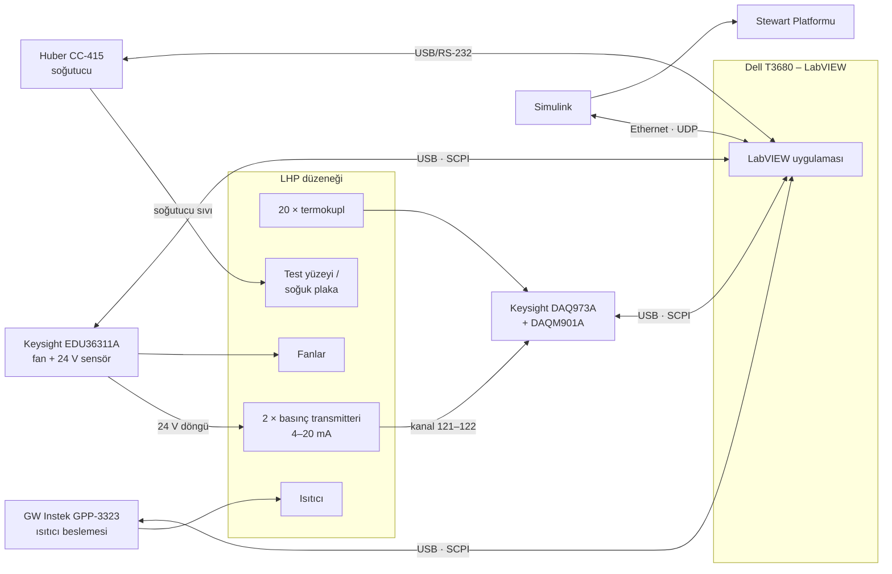

# Sistem Mimarisi

> Taslak – ekipman ayrıntıları: [ekipman.md](ekipman.md), kanallar: [kanal-plani.md](kanal-plani.md)

## 1. Fiziksel sistem

- **Evaporatör tarafı:** GPP-3323 ile beslenen elektrikli ısıtıcı evaporatörü ısıtır. Bu ısı, uçaktaki atık ısıyı temsil eder. Çalışma akışkanı burada buharlaşır.
- **Buhar ve sıvı hatları:** Buhar kondensere, yoğuşan sıvı kılcal kuvvetle evaporatöre geri döner.
- **Kondenser tarafı:** Kondenser, kanat hücum kenarını temsil eden soğuk test yüzeyine termal olarak bağlıdır. Test yüzeyi Huber CC-415 soğutucusuyla düşük sıcaklığa getirilir. Fanlar soğutma koşullarını değiştirmek için kullanılır.

Düzenek İTÜ'de kurulacak, dinamik testler için Türk-Alman Üniversitesi'ndeki Stewart Platformu'na taşınacaktır.

## 2. Bağlantı şeması

## 3. LabVIEW uygulamasının modülleri

Her cihaz için ayrı bir sürücü katmanı yazılır. Üst katman cihazlardan bağımsız çalışır.

| Modül | Görev |
|---|---|
| `instruments/daq973a` | Kanal yapılandırma (TC tipi, akım kanalları, Mx+B), tarama başlatma, veri okuma |
| `instruments/gpp3323` | Gerilim/akım ayarı, çıkış aç/kapa, V/I geri okuma, OVP/OCP |
| `instruments/edu36311a` | Fan gerilimi, 24 V döngü beslemesi, geri okuma |
| `instruments/huber` | Hedef sıcaklık, banyo/proses sıcaklığı okuma, başlat/durdur |
| `platform` | Simulink ile UDP haberleşmesi |
| `control` | Isıtıcı (sabit güç / PID), fan kontrolü, soğutucu hedefi |
| `safety` | Limitler, alarmlar, acil kapatma |
| `logging` | Tüm verilerin tek zaman ekseninde CSV/TDMS kaydı |
| `ui` | Canlı grafikler, göstergeler, deney ayarları |

Önerilen yapı **üretici–tüketici (producer–consumer)** döngüleridir: ölçüm, kontrol, platform haberleşmesi ve kayıt ayrı döngülerde çalışır, kuyruklarla veri alışverişi yapar.

**Zamanlama (öneri):**
- DAQ taraması: 1 s (20 TC + 2 akım ≈ 0,5 s sürer)
- Güç kaynağı geri okuma: 1 s
- Soğutucu: 1–2 s
- Platform haberleşmesi: 50–100 ms (ayrı döngü)

## 4. Güvenlik

Katmanlı koruma:

1. **Donanım:** GPP-3323 ve EDU36311A'da OVP/OCP sınırları ayarlanır. Huber'in kendi aşırı sıcaklık koruması vardır.
2. **DAQ:** Kritik kanallara (ör. T_HTR) alarm limiti tanımlanır. Alarm çıkışı PC'den bağımsız çalışır.
3. **LabVIEW:**
   - T_HTR veya T_EV limit üstü → ısıtıcı çıkışı kapatılır
   - Basınç limit üstü → ısıtıcı kapatılır
   - Kopuk termokupl → uyarı. Kritik kanaldaysa ısıtıcı kapatılır.
   - Bir cihazla haberleşme koparsa → ısıtıcı kapatılır
4. **Platform:** Haberleşme kesildiğinde güvenli konuma dönüş Simulink tarafında sağlanır. Acil durdurma butonu LabVIEW'dan bağımsızdır.

## 5. Stewart Platformu entegrasyonu

Ayrıntılar: [labview-simulink-haberlesme.md](labview-simulink-haberlesme.md)

Platform testlerinde DAQ, güç kaynakları ve (mümkünse) bilgisayar platform dışında sabit durur. Platform üzerindeki düzenekten çıkan termokupl kabloları, güç kabloları ve soğutucu hortumları hareket aralığını karşılayacak boyda ve sabitlenmiş olmalıdır.
