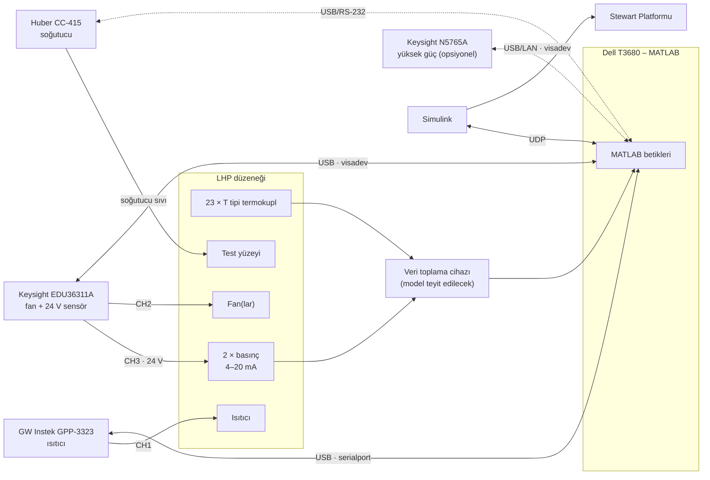

# Sistem Mimarisi

> Taslak. Ekipman ayrıntıları: [ekipman.md](ekipman.md), kanallar: [kanal-plani.md](kanal-plani.md), MATLAB komutları: [../matlab/README.md](../matlab/README.md)

## Alınan kararlar (Kasım 2026)

| Konu | Önceki plan | Yeni karar | Gerekçe |
|---|---|---|---|
| Kontrol ve kayıt yazılımı | LabVIEW | **MATLAB** | Güç kaynakları MATLAB'dan sorunsuz kontrol edildi. Simulink ile aynı ortamda olması platform entegrasyonunu kolaylaştırıyor. |
| Veri toplama cihazı | Keysight DAQ973A | **Yeni cihaz** (model teyit edilecek) | Laboratuvar çalışmaları sonucunda değiştirildi |
| Termokupllar | 20 adet, tip belirsiz | **23 × T tipi** (9 + 9 + 5) | Ölçüm noktaları genişletildi |

## 1. Fiziksel sistem

- **Evaporatör tarafı:** GPP-3323 ile beslenen kartuş ısıtıcı evaporatörü ısıtır. Bu ısı, uçaktaki atık ısıyı temsil eder.
- **Buhar ve sıvı hatları:** Buhar kondensere, yoğuşan sıvı kılcal kuvvetle evaporatöre geri döner.
- **Kondenser tarafı:** Kondenser, kanat hücum kenarını temsil eden test yüzeyine bağlıdır. Test yüzeyi soğutucuyla (Huber, teyit edilecek) düşük sıcaklığa getirilir. Fanlar soğutma koşullarını değiştirir.

Düzenek İTÜ'de kurulacak, dinamik testler için Türk-Alman Üniversitesi'ndeki Stewart Platformu'na taşınacaktır.

## 2. Bağlantı şeması

Düz çizgiler test edilmiş ya da kesinleşmiş bağlantılar, kesikli çizgiler planlanan bağlantılardır.

## 3. MATLAB uygulamasının bölümleri

| Bölüm | Görev | Durum |
|---|---|---|
| Güç kaynağı bağlantıları | GPP-3323 (`serialport`), EDU36311A (`visadev`) | ✓ Çalışıyor |
| Isıtıcı kontrolü | Sabit gerilim, sabit güç (V·I geri beslemesi), güç basamakları | ✓ Betik hazır |
| Fan kontrolü | Gerilimle hız ayarı | ✓ Betik hazır |
| Sıcaklık okuma | Yeni DAQ'tan 23 termokupl | Bekliyor (DAQ modeli) |
| Basınç okuma | 2 × 4–20 mA | Bekliyor |
| Güvenlik | Limitler, otomatik kapatma | Kısmen (süre sınırı, `onCleanup`) |
| Kayıt | Tüm büyüklükler tek zaman ekseninde CSV | Kısmen (ısıtıcı verisi) |
| Platform arayüzü | Simulink ile UDP | Bekliyor |

**Program yapısı (öneri):** Tek bir ana döngü her saniye sırayla DAQ'ı okur, güç kaynaklarını geri okur, kontrol kararını verir, güvenlik kontrolünü yapar ve bir satır kayıt yazar. Platform haberleşmesi daha sık gerekiyorsa MATLAB `timer` nesnesiyle ayrı bir döngüde çalıştırılabilir.

## 4. Güvenlik

Katmanlı koruma:

1. **Donanım:** Güç kaynaklarında OVP/OCP ve akım sınırları ayarlanır. OCP, akım sınırından yüksek tutulur.
2. **MATLAB:**
   - `T_HTR` veya `T_EV_xx` limit üstü → ısıtıcı kapatılır
   - Sıcaklık hızla yükseliyorsa ($dT/dt$ limiti) → ısıtıcı kapatılır (kuruma tespiti)
   - Basınç limit üstü → ısıtıcı kapatılır
   - Bir cihazla haberleşme koparsa → ısıtıcı kapatılır
   - Betik hata verirse veya Ctrl+C ile durdurulursa → `onCleanup` ile çıkışlar kapatılır
3. **Operatör:** Isıtıcı açıkken düzeneğin başında biri bulunur. Acil durumda güç kaynağının ön panelinden çıkış kapatılır.
4. **Platform:** Haberleşme kesildiğinde güvenli konuma dönüş Simulink tarafında sağlanır.

## 5. Stewart Platformu entegrasyonu

Ayrıntılar: [matlab-simulink-haberlesme.md](matlab-simulink-haberlesme.md)
