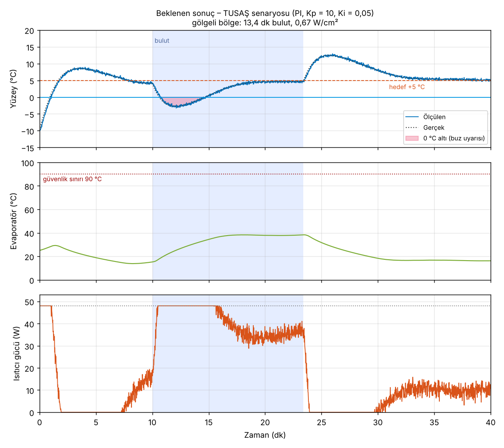

# TUSAŞ Buzlanma Tasarım Koşulları

TUSAŞ'tan Kasım 2026'da gelen buzlanma koşulları. Kontrol sisteminin **hedefini**, **test senaryosunu** ve **güç ihtiyacını** bu değerler belirliyor.

## 1. Gelen veriler

| Parametre | Değer |
|---|---|
| Ortam sıcaklığı | −10 °C (ISA −5 °C) |
| Basınç irtifası | 10 000 ft (3 048 m) |
| Statik basınç | 69,7 kPa |
| Hava yoğunluğu | 0,922 kg/m³ |
| Hız (V) | 40 m/s (ANKA seyir hızı) |
| Sıvı su içeriği (LWC) | 0,5 g/m³ |
| Damla çapı (MVD) | 20 µm |
| Bulut uzunluğu | 17,4 nmi → **13,4 dk maruziyet** |
| Isı gereksinimi | **0,67 W/cm²** |
| Buzlanma için izdüşüm alanı (tek kanat) | 0,92 m² |

## 2. Bizim için anlamı

| Veri | Kontrol sistemindeki karşılığı |
|---|---|
| −10 °C ortam | Test yüzeyinin soğutulacağı sıcaklık (`T_soguk`). Simülasyonda soğuk taraf ortamı. |
| 0,67 W/cm² | Buzlanma sırasında yüzeyden çekilen ısı. Isıtıcı + LHP bu akıyı karşılamalı. |
| 13,4 dk | Test senaryosundaki "bulut" süresi (`t_bulut_sure` = 804 s). |
| 0,92 m² | Gerçek kanat için toplam güç: 0,67 W/cm² × 9 200 cm² ≈ **6,2 kW** (tek kanat). |
| Hız, basınç, yoğunluk, LWC, MVD | 0,67 W/cm² değerinin hesabındaki girdiler. Kontrolcüye doğrudan girmiyor, rapor ve tasarım için önemli. |

### Kontrol hedefi

Kontrol edilen büyüklük artık ısıtıcı sıcaklığı değil, **test yüzeyinin sıcaklığı**. Gerçek sistemde en soğuk yüzey noktası kullanılacak: `min(T_SURF_01…05)`, büyük olasılıkla `T_SURF_05` (kondenser çıkışı tarafı, [kanal-plani.md](kanal-plani.md)).

- Hedef: **+5 °C** (0 °C'ye 5 °C güvenlik payı)
- Yüzey, buzlanma sırasında 0 °C'nin altına düşerse → **buz uyarısı** (ısıtıcı kapanmaz, kayda geçer)
- Evaporatör/ısıtıcı tarafı `T_limit`'i (varsayılan 90 °C) aşarsa → **ısıtıcı kapanır**

### Laboratuvar ölçeği

Aynı ısı akısının (0,67 W/cm²) laboratuvardaki test yüzeyine verilmesi için gereken güç:

| Isıtıcı gücü | Bu akıyla karşılanabilecek yüzey (kayıpsız) | Önerilen yüzey (%30 pay ile) |
|---|---|---|
| 48 W (GPP-3323 + 5,33 Ω ısıtıcı) | ≈ 72 cm² | ≈ **50 cm²** (≈ 7 × 7 cm) |
| 1 500 W (N5765A) | ≈ 2 240 cm² | ≈ 1 600 cm² (≈ 40 × 40 cm) |

LHP ve hatlardaki kayıplar yüzünden ısıtıcı gücünün tamamı yüzeye ulaşmaz. Bu nedenle %30 pay bırakıldı.

## 3. Test senaryosu

```
 0 dk            10 dk                          23,4 dk            40 dk
 ├── ısınma ──────┼──── BULUT (13,4 dk) ─────────┼──── bulut sonrası ─┤
   yüzey −10 °C'den    yüzeyden 0,67 W/cm² çekilir    normal soğutma
   +5 °C'ye çıkar      yüzey 0 °C üstünde kalmalı
```

## 4. Simülasyondaki model ve varsayımlar

`matlab/sicaklik_kontrol.m` ve `simulink/lhp_kontrol.slx` aynı iki düğümlü modeli kullanır:

```
 Isıtıcı P ──▶ [Evaporatör C_ev] ──LHP (R_lhp)──▶ [Test yüzeyi C_yuzey] ──▶ soğuk taraf (−10 °C)
                     │                                     │
               oda kaybı (R_ev_kayip)                bulutta ek yük
```

| Parametre | Değer | Kaynak |
|---|---|---|
| `T_soguk` | −10 °C | **TUSAŞ** |
| `q_buz` | 0,67 W/cm² | **TUSAŞ** |
| `t_bulut_sure` | 804 s (13,4 dk) | **TUSAŞ** |
| `A_yuzey` | 50 cm² | Varsayım (48 W ısıtıcıya göre, yukarıdaki tablo) |
| `T_hedef` | +5 °C | Varsayım (0 °C + 5 °C pay) |
| `C_ev` | 300 J/°C | Varsayım (≈ 0,8 kg bakır blok) |
| `C_yuzey` | 150 J/°C | Varsayım (ince alüminyum plaka + bağlantılar) |
| `R_lhp` | 1,0 °C/W | Varsayım (küçük LHP, literatürde 0,1–1 °C/W) |
| `R_ev_kayip` | 10 °C/W | Varsayım (yalıtılmış evaporatör, oda 25 °C) |
| `h_kuru` | 150 W/m²K | Varsayım (bulut dışı soğutma) |

Buzlanma sırasında yüzeyden çekilen toplam ısı, yüzey hedefteyken 0,67 W/cm² olacak şekilde hesaplanır: kuru soğutma + su damlalarının getirdiği ek yük.

### Simülasyon sonucu (Kp = 10, Ki = 0,05)



- Yüzey yaklaşık 1,5 dakikada 0 °C'yi, sonra hedefi geçiyor; başlangıçta ≈ 8,5 °C'ye kadar aşım yapıp 8. dakikada +5 °C'ye oturuyor. Aşımın nedeni, odada 25 °C'de başlayan evaporatörün depoladığı ısı.
- Bulut boyunca gereken güç ≈ 34 W (48 W'ın %70'i). Bulutun ilk 5 dakikasında ısıtıcı tam güçte (48 W) çalışıyor.
- **Bulut başladığında yüzey ≈ 4 dakika 0 °C'nin altına iniyor (en düşük ≈ −3 °C).** Neden: gereken güç bir anda ≈ 15 W'tan ≈ 34 W'a çıkıyor, ama ısının yüzeye ulaşması için önce evaporatör bloğunun ≈ 25 °C daha ısınması gerekiyor. Kazançlar artırılsa da bu süre ancak biraz kısalıyor; asıl sınırlayıcı evaporatörün ısıl kütlesi.
- Bulut bitince yük birden kalktığı için yüzey ≈ 12,5 °C'ye çıkıyor, sonra yavaşça hedefe dönüyor.
- Önlem seçenekleri: (1) evaporatör/ısıtıcı bloğunu hafif tutmak (C_ev = 100 J/°C ile 0 °C altında kalma süresi 4 dakikadan ≈ 30 saniyeye iniyor, en düşük ≈ −0,5 °C), (2) bulut boyunca hedefi yükseltmek, (3) buzlanma algılandığı anda ısıtıcıyı önceden artırmak (ileri besleme). Bu, gerçek düzenekte ölçülmesi gereken önemli bir davranış.

Bu sonuçlar varsayılan parametrelere bağlıdır. Gerçek düzenekle ilk ölçümler yapılınca `C_ev`, `C_yuzey` ve `R_lhp` ölçülen değerlerle güncellenmelidir.

## 5. Açık sorular

- [ ] Laboratuvardaki test yüzeyinin alanı ne olacak?
- [ ] 0,67 W/cm² hangi yüzey sıcaklığı için hesaplandı (0 °C mi, daha yüksek mi)? Tüm izdüşüm alanına mı, yoksa sadece hücum kenarına mı uygulanıyor?
- [ ] Huber CC-415 test yüzeyini −10 °C'ye indirebiliyor mu?
- [ ] Laboratuvarda 40 m/s rüzgâr etkisi fanla taklit edilecek mi, yoksa sadece soğuk yüzeyle mi çalışılacak?
- [ ] Buzlanma yükü laboratuvarda nasıl uygulanacak (chiller sıcaklığı/debisi, fan hızı)?
