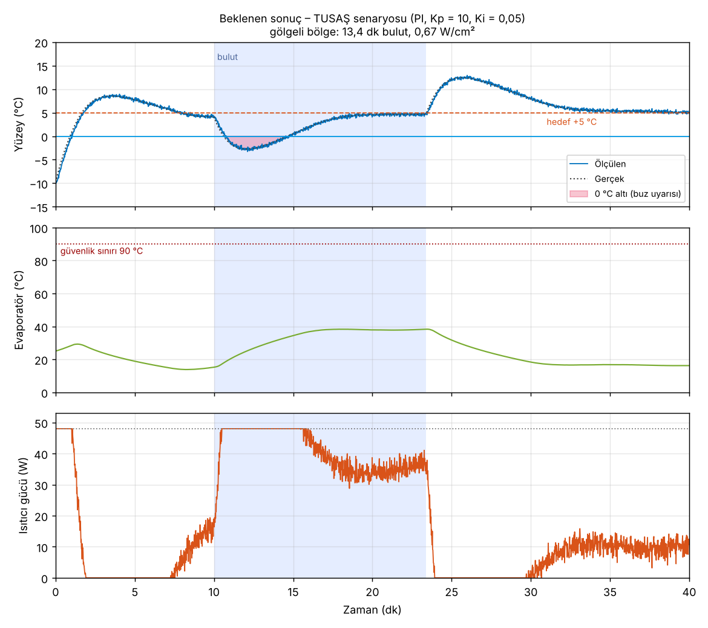

# Simulink

## 1. Sıcaklık kontrol modeli (`lhp_kontrol.slx`)

Isıtıcı gücünü PI kontrolcüsüyle ayarlayarak **test yüzeyini +5 °C'de** tutan model. Senaryo TUSAŞ buzlanma koşullarından geliyor: soğuk taraf −10 °C, 10. dakikada başlayıp 13,4 dakika süren bir bulut, bulut boyunca 0,67 W/cm² ısı gereksinimi ([../docs/tusas-buzlanma-kosullari.md](../docs/tusas-buzlanma-kosullari.md)). Şimdilik gerçek düzenek yerine **sanal bir ısıl model** kullanır. Mantık `matlab/sicaklik_kontrol.m` ile aynıdır.

`.slx` dosyası repoda tutulmaz, betikle üretilir. Böylece değişiklikler git'te satır satır görülebilir.

### Kurulum ve çalıştırma

MATLAB'da bu klasöre geçip komut penceresine yazın:

```matlab
lhp_kontrol_modeli_olustur   % modeli kurar, lhp_kontrol.slx olarak kaydeder ve açar (eski model varsa üzerine yazar)
lhp_kontrol_calistir         % çalıştırır, özet yazar, grafik çizer, CSV kaydeder
```

Model açıkken Simulink'teki **Run** düğmesiyle de çalışır. `Yuzey_Sicakligi`, `Evaporator` ve `Guc` scope'larına çift tıklayıp canlı izleyebilirsiniz. `Guc` scope'unda ikinci çizgi bulut sinyalidir (bulut varken 48'de durur).

Parametre değiştirmek için:

```matlab
T_hedef = 8;  Kp = 15;  lhp_kontrol_calistir
lhp_kontrol_parametreler     % varsayılanlara döner
```

Gereken: MATLAB + Simulink (ek toolbox gerekmez).

### Modelin yapısı

```
 Hedef ─▶ Hata ─▶ PI_Kontrolcu ─▶ Guvenlik ─▶ Duzenek_SANAL ─┬─▶ T_yuzey_olc (kontrol edilen)
           ▲                       ▲ ▲ ▲ ▲                    ├─▶ T_ev_olc   (güvenlik)
           └───────────────────────┘ │ │ │                    │
                  T_ev_olc ──────────┘ │ │                    │
                  Harici_Stop ─────────┘ │                    │
                  Senaryo_TUSAS (bulut) ─┴────────────────────┘
```

| Blok | Ne yapar |
|---|---|
| `PI_Kontrolcu` | Simulink Discrete PID bloğu (PI modu). Test yüzeyi sıcaklığını kontrol eder. Çıkış 0–`P_max` W, clamping anti-windup açık |
| `Guvenlik` | Evaporatör `T_limit`'i (90 °C) aşarsa, bir sensör arızalıysa (< −50 °C) veya `Harici_Stop` > 0 ise gücü 0 yapar, kapalı tutar. Bulut varken yüzey 0 °C'nin altındaysa `buz_uyari` verir (ısıtıcı kapanmaz) |
| `Senaryo_TUSAS` | Bulut sinyali: 600. saniyede 1 olur, 804 s (13,4 dk) sonra 0 olur |
| `Duzenek_SANAL` | İki düğümlü ısıl model: ısıtıcı → evaporatör → LHP → test yüzeyi → soğuk taraf (−10 °C). Bulut varken yüzeyden ek ısı çekilir. Sensör gecikmesi ve gürültüsü eklenir |
| `Harici_Stop` | Şimdilik sabit 0. Stewart Platformu eklenince platformun acil stop sinyali buraya bağlanacak |
| `Kayit` | Sonuçları `kayit` değişkenine yazar: T_hedef, T_yuzey_olc, P_W, T_yuzey, T_ev, alarm, buz_uyari, bulut |

### Beklenen sonuç



Varsayılan parametrelerle bulut başında yüzey ≈ 4 dakika 0 °C'nin altına iner (en düşük ≈ −3 °C). Nedeni ve önlemler: [../docs/tusas-buzlanma-kosullari.md](../docs/tusas-buzlanma-kosullari.md).

### Sonraki adımlar

1. **Gerçek ısıtıcı:** `Duzenek_SANAL` yerine gücü GPP-3323'e yazan bir blok (MATLAB System bloğu, `serialport`). Giriş `P_W`, çıkışlar `T_yuzey_olc` ve `T_ev_olc` aynı kalacak.
2. **Gerçek sensör:** DAQ netleşince `T_yuzey_olc = min(T_SURF_01…05)`, `T_ev_olc = T_HTR`.
3. **Model parametreleri:** Gerçek düzenekte `C_ev`, `C_yuzey`, `R_lhp` ölçülüp `lhp_kontrol_parametreler.m` güncellenecek.
4. **Stewart Platformu:** UDP Receive ile platform durumu ve acil stop, `Harici_Stop` girişine bağlanır.

## 2. Stewart Platformu haberleşmesi (sonra)

Stewart Platformu'nun Simulink modeli Türk-Alman Üniversitesi'ne aittir. Bu klasörde yalnızca haberleşme için eklenen bloklar, test modelleri ve notlar tutulacak.

- `udp_interface_test.slx`: platform olmadan UDP haberleşmesini test etmek için basit model
- Platform modeline eklenecek UDP Send/Receive bloklarının açıklaması

Mesaj formatı: [../docs/matlab-simulink-haberlesme.md](../docs/matlab-simulink-haberlesme.md)
